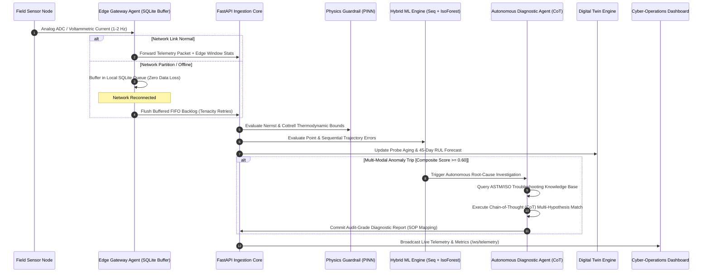

# StreamPulse AI — Technical Architecture & Mathematical Foundations

## 1. System Overview

StreamPulse AI is a distributed, event-driven industrial IoT telemetry, physics-informed anomaly detection, and autonomous diagnostic platform. The architecture decouples edge-level store-and-forward computing from high-throughput cloud ingestion, hybrid machine learning, and autonomous agentic root-cause remediation.

---

## 2. Mathematical Formulations & Physical Sensor Modeling

### 2.1 Physics-Informed Nernstian Temperature Compensation
Glass pH electrodes measure the galvanic potential across a hydrated lithium silicate glass membrane relative to an $\text{Ag/AgCl}$ internal reference electrode in saturated $\text{KCl}$. The thermodynamic cell potential $E_{\text{cell}}$ obeys the Nernst equation:

$$E_{\text{cell}} = E^0 - \frac{2.302585 \cdot R \cdot (T_{{}^\circ\text{C}} + 273.15)}{F} \cdot (\text{pH} - 7.00)$$

Where:
- $E^0$: Standard electrode potential ($\text{mV}$)
- $R$: Universal gas constant ($8.314462\ \text{J}\cdot\text{mol}^{-1}\cdot\text{K}^{-1}$)
- $F$: Faraday constant ($96,485.33\ \text{C}\cdot\text{mol}^{-1}$)
- $T_{{}^\circ\text{C}}$: Process temperature measured by a Class A Pt100 RTD sensor.

The theoretical slope factor $S(T)$ represents sensitivity per pH unit:

$$S(T) = \frac{2.302585 \cdot R \cdot (T + 273.15)}{F} \approx 0.05417 + 0.0001984 \cdot T_{{}^\circ\text{C}}\quad [\text{V/pH}]$$

**The PINN Thermodynamic Guardrail:**
If the measured sensor potential divergence exceeds the allowable thermodynamic envelope:

$$\left| \frac{\Delta E}{\Delta \text{pH}} - S(T) \right| > \epsilon_{\text{nernst}} \quad (\epsilon \approx 0.08 \cdot S(T))$$

the system flags a **Thermodynamic Violation**, distinguishing sensor hardware failure from true chemical pH fluctuations.

### 2.2 Voltammetric Electron Transfer Kinetics & Passivation
For electrochemical potentiostat cells operating at applied potential $E_{\text{appl}} = 0.45\text{V}$, the Faradaic diffusion current $I(t)$ follows Cottrell kinetics:

$$I(t) = \frac{n \cdot F \cdot A_{\text{eff}}(t) \cdot D^{1/2} \cdot C^*}{\pi^{1/2} \cdot t^{1/2}}$$

Under surface biofouling or protein deposition, an insulating dielectric layer forms on the platinum working electrode, attenuating the electroactive surface area according to an exponential passivation function:

$$A_{\text{eff}}(t) = A_0 \cdot \exp(-\kappa_{\text{bio}} \cdot t)$$

The **Kinetics Guardrail** computes the current density ratio $\frac{I_{\text{ec}}}{\text{Turbidity}}$ to detect surface passivation before complete signal flatlining occurs.

---

## 3. Hybrid Anomaly Detection & Autonomous Agentic Diagnostics

### 3.1 Dual-Model Multi-Modal Fusion
StreamPulse AI fuses two distinct model paradigms:
1. **Unsupervised Multivariate Isolation Forest:** Evaluates recursive binary tree path lengths to detect instantaneous point anomalies across 9 engineered physical dimensions.
2. **Sequential Drift Autoencoder:** Evaluates a sliding temporal window of length $L=12$ frames to compute the sequential trajectory reconstruction error:

$$\mathcal{E}_{\text{seq}} = \frac{1}{M} \sum_{j=1}^{M} \frac{\left| \text{Var}(X_j) - \sigma_{\text{nominal}, j}^2 \right|}{\sigma_{\text{nominal}, j}^2 + \varepsilon} + \alpha \cdot \left| \frac{d X_0}{dt} \right|$$

This catches subtle, monotonic multi-hour reference junction leakage that point classifiers miss.

### 3.2 Autonomous Agent Chain-of-Thought (CoT) Workflow
When composite score $\mathcal{S}_{\text{composite}} \ge 0.60$:
1. **Signal Profiling:** Extracts telemetry channels, Nernstian slope, and signal-to-noise ratio (SNR).
2. **TreeSHAP Attribution:** Calculates exact Shapley values $\phi_i(x)$ across features:
   $$\text{Attribution}(X_i) = \frac{|\phi_i(x)|}{\sum_k |\phi_k(x)|} \times 100\%$$
3. **ASTM/ISO Vector Knowledge Store Retrieval:** Evaluates feature signatures against standard failure modes:
   - `BIOFOULING` $\to$ **ASTM D1293 / SOP-410** (-1.2V cleaning pulse or alumina slurry polish).
   - `JUNCTION_POISON` $\to$ **EPA 150.1 / SOP-705** (Thiourea/HCl chemical unclogging).
   - `DRIFT` $\to$ **ISO 17025 / SOP-702** (Two-point buffer recalibration).
   - `FLATLINE_FAIL` $\to$ **OSHA 1910 / SOP-102** (Emergency probe lockout/tagout).
   - `CAVITATION_SPIKE` $\to$ **ANSI/HI 9.6.1 / SOP-301** (Suction head stabilization).
4. **Diagnostic Memo Generation:** Outputs an audit-grade report complete with downtime estimates and step-by-step remediation procedures.

---

## 4. Digital Twin Degradation Kinetics

Each sensor station is governed by a Digital Twin state model:

$$H(t) = H_0 \cdot \exp\left( -\lambda_{\text{nominal}} \cdot \left(1 + \sum_{k} \gamma_k \cdot \mathcal{C}_k\right) \cdot t \right)$$

Where:
- $H(t)$: Health Index ($0 - 100\%$)
- $\lambda_{\text{nominal}}$: Baseline wear rate ($0.25\%\text{/day}$)
- $\mathcal{C}_k$: Environmental stress cycles logged (thermal shock $>35^\circ\text{C}$, high-pH exposure $\text{pH} > 10$, cavitation spikes)
- $\gamma_k$: Stress acceleration coefficients.

The **Remaining Useful Life (RUL)** in days is derived by solving for the time until health crosses the critical replacement threshold ($H_{\text{crit}} = 40\%$):

$$\text{RUL}_{\text{days}} = \frac{\ln(H(t)) - \ln(H_{\text{crit}})}{\lambda_{\text{effective}}}$$

---

## 5. Edge Store-and-Forward Network Partition Tolerance

During field network drops, the Edge Gateway Agent captures frames in an embedded SQLite queue:
- **Enqueue:** $O(1)$ indexed transactional insertion into `edge_telemetry_buffer`.
- **Drain Worker:** Employs an exponential backoff retry policy using `tenacity`:
  $$t_{\text{wait}} = \min(t_{\text{max}}, t_{\text{min}} \cdot 2^{\text{attempt}}) \pm \text{jitter}$$
- **Data Integrity:** Guarantees FIFO transmission order and zero packet loss during cloud outages.
