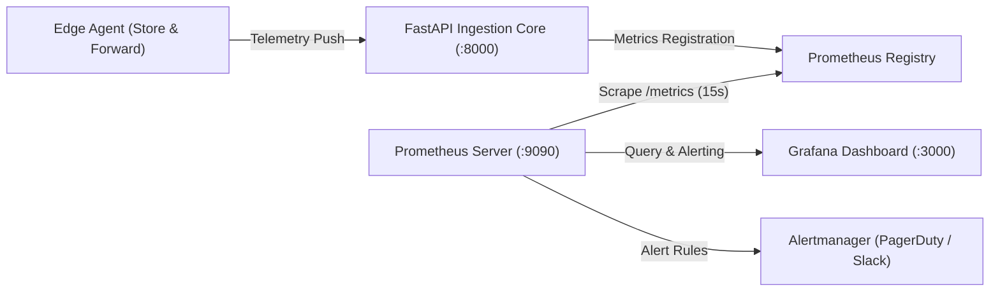

# StreamPulse AI — Prometheus Observability & Metrics Specification

This document specifies the Prometheus monitoring architecture, metric definitions, scrape configurations, and SLI/SLO alerts implemented in **StreamPulse AI**.

---

## 1. Observability Architecture

StreamPulse AI exposes Prometheus metrics natively via the `/metrics` endpoint on the FastAPI Core service (port 8000), using the standard Prometheus text-based exposition format (`CONTENT_TYPE_LATEST = "text/plain; version=0.0.4; charset=utf-8"`).



---

## 2. Core Industrial Metrics Catalog

### 2.1 Ingestion & Throughput Metrics

| Metric Name | Type | Labels | Description |
| :--- | :--- | :--- | :--- |
| `streampulse_telemetry_ingested_total` | Counter | `node_id` | Cumulative count of valid industrial sensor packets ingested across all fluidic skids. |
| `streampulse_queue_depth` | Gauge | — | Instantaneous backlog of packets buffered in the asynchronous in-memory / Redis ingestion queue. |
| `streampulse_edge_buffer_depth` | Gauge | `node_id` | Cumulative count of sensor packets stored locally in SQLite edge databases during network partition events. |

### 2.2 Machine Learning & Physics-Informed (PINN) Metrics

| Metric Name | Type | Labels | Description |
| :--- | :--- | :--- | :--- |
| `streampulse_inference_duration_seconds` | Histogram | — | End-to-end execution latency for PINN thermodynamic checks, Isolation Forest, Sequential Drift Autoencoder, and TreeSHAP attribution. <br/>Buckets: `[1ms, 3ms, 8ms, 15ms, 30ms, 60ms, 120ms, 250ms, 500ms, 1s]`. |
| `streampulse_pinn_violations_total` | Counter | — | Total count of thermodynamic (Nernstian slope breach) or electrochemical kinetics (Cottrell passivation) violations detected. |
| `streampulse_anomalies_detected_total` | Counter | `severity`, `node_id` | Total count of confirmed anomaly incidents tripping the composite threshold ($\mathcal{S} \ge 0.60$). |
| `streampulse_agent_diagnostics_total` | Counter | — | Total count of automated root-cause diagnostic tickets synthesized by the Autonomous AI Agent. |

---

## 3. Prometheus Scrape Configuration (`prometheus.yml`)

```yaml
global:
  scrape_interval: 5s
  evaluation_interval: 5s

scrape_configs:
  - job_name: 'streampulse-core'
    static_configs:
      - targets: ['backend:8000']
    metrics_path: '/metrics'
    scrape_timeout: 3s
```

---

## 4. Production Alerting Rules (PromQL)

### Alert 1: Catastrophic Hardware Membrane Fracture
```promql
sum(rate(streampulse_pinn_violations_total[1m])) > 5
```
* **Severity:** Critical  
* **Action:** PagerDuty trigger to Sustaining Engineering on-call. Shuts off influent chemical dosing pump to prevent acidification.

### Alert 2: Sub-15ms Ingestion Latency SLA Violation
```promql
histogram_quantile(0.99, sum(rate(streampulse_inference_duration_seconds_bucket[5m])) by (le)) > 0.015
```
* **Severity:** Warning  
* **Action:** Triggers auto-scaling of worker containers or inspection of database indexing locks.

### Alert 3: Edge Network Partition Backpressure
```promql
streampulse_edge_buffer_depth > 500
```
* **Severity:** Warning  
* **Action:** Alerts network infrastructure team to investigate switch/cellular gateway failure on field skid.

---

## 5. Service Level Indicators & Objectives (SLI / SLO)

| Indicator (SLI) | Target Objective (SLO) | Measured Metric |
| :--- | :--- | :--- |
| **Ingestion Availability** | 99.95% uptime | `sum(rate(http_requests_total{status=~"2.."}[5m])) / sum(rate(http_requests_total[5m]))` |
| **Inference Latency SLA** | p99 < 15ms | `histogram_quantile(0.99, rate(streampulse_inference_duration_seconds_bucket[5m]))` |
| **Zero Data Loss Guarantee** | 0 lost packets during partition | Verified by `streampulse_edge_buffer_depth` draining to 0 post-reconnection. |
